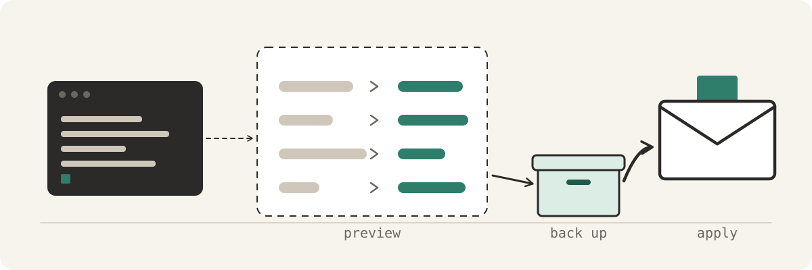

<p align="center">
  
</p>

# actual-budget-cli

A careful command line for [Actual Budget](https://actualbudget.org/). Read your budget,
accounts, rules and reports from a terminal, and change them **only after you have seen the
change**. Every write is previewed first, backed up, and logged.

```text
$ actual-budget budget move 2026-11 50 "Emergency Fund" "Car"
2026-11 budget changes

Category        Budgeted now     New  Balance after
Emergency Fund      1,000.00  950.00         950.00
Car                     0.00   50.00          50.00

2026-11 to budget: 0.00 → 0.00

Dry run, nothing written. Re-run with --apply to make this change.
```

It is built on [`@actual-app/api`](https://actualbudget.org/docs/api/), Actual's own library,
and talks to your Actual sync server the same way the app does. It never touches Actual's
database file directly. It is an independent project, not affiliated with Actual Budget.

## Why

Scripts and AI assistants are handy for budget chores: moving money between categories,
writing rules, recategorising a month of transactions. They are also easy to get slightly
wrong. This tool makes the safe path the default one:

- **Preview by default.** No command changes anything unless you add `--apply`. Without it you
  get a before → after table and, for budget changes, what the month's *To Budget* becomes.
- **Backup before every write.** `--apply` exports the whole budget first, in the zip format
  Actual's *Import budget* accepts, so any change can be undone.
- **Version guard.** Writes are refused unless the library and your server share a version
  (see [Versions](#versions)).
- **A log of every change.** Each applied change is appended to `writes.log`, with its backup.
- **No destructive shortcuts.** Accounts are closed rather than deleted, categories hidden
  rather than deleted, and transfers and split transactions are left to the app, because
  Actual's API docs warn they do not update reliably through the API.

## Requirements

- Node.js 22 or later.
- An Actual sync server you can reach. The Actual desktop app runs one for you; check
  *Settings → Advanced* for its address, or use your self-hosted server's URL.
- The budget's **Sync ID**, from *Settings → Show advanced settings → Sync ID*.

## Install

```bash
git clone https://github.com/MaterDev/actual-budget-cli.git
cd actual-budget-cli
npm ci --ignore-scripts
npm link            # optional: puts `actual-budget` on your PATH
```

Without `npm link`, run `node bin/actual-budget.mjs` wherever this README says `actual-budget`.

## Setup

**1. Pin the library to your server's version.** Find it in the app's About box, or:

```bash
curl -s http://localhost:5006/info     # use your server's address
```

```bash
npm install --ignore-scripts --save-exact @actual-app/api@<that version>
```

**2. Write the config file.** It holds no secrets: just where the server is and which budget
to open. It is saved to `~/.config/actual-budget-cli/config.json` (or `$XDG_CONFIG_HOME`).

```bash
actual-budget init --server http://localhost:5006 --sync-id <your-sync-id>
```

**3. Give it the server password.** The tool never stores your password itself.

- **macOS:** keep it in the login Keychain, and name the item in the config:

  ```bash
  security add-generic-password -a "$USER" -s actual-budget -w     # prompts; nothing is echoed
  actual-budget init --server http://localhost:5006 --sync-id <id> --keychain-service actual-budget
  ```

- **Anywhere else:** export `ACTUAL_PASSWORD` in the shell that runs the tool.

For an end-to-end encrypted budget, also set `ACTUAL_BUDGET_ENCRYPTION_PASSWORD`, or
`"encryptionKeychainService"` in the config.

**4. Check it.**

```bash
actual-budget status
# server http://localhost:5006  ·  Actual server 26.11.0  ·  library 26.11.0
# Versions match: writes allowed.
```

After the first login the tool keeps a session token (in the Keychain on macOS, otherwise in a
user-only file) and reuses it, so it does not trip the server's login rate limit.

## Usage

```bash
actual-budget                    # every command with its usage
actual-budget <area> <action> [args] [--flags]
```

| Area | Reads | Changes (preview, then `--apply`) |
|---|---|---|
| `budget` | `month`, `months`, `note` | `set`, `move`, `carryover`, `hold`, `hold-reset`, `note` |
| `categories` | `list` | `add`, `rename`, `move`, `hide`, `unhide`, `group-add`, `group-rename` |
| `accounts` | `list`, `balance` | `add`, `rename`, `close`, `reopen` |
| `txns` | `list` | `add`, `categorize`, `note`, `payee` |
| `payees` | `list` | `rename`, `merge` |
| `rules` | `list`, `show`, `test` | `add`, `update`, `delete` |
| `reports` | `spending`, `cashflow`, `budget-vs-actual`, `overspent`, `trend`, `networth` | — |

Names are matched forgivingly: exact name first, then a unique case- and emoji-insensitive
match, then a unique substring. An ambiguous name stops with the list of candidates. Amounts are
in dollars on the command line, negative for spending. Dates are `YYYY-MM-DD`, months `YYYY-MM`.

### Budget

```bash
actual-budget budget month 2026-11
actual-budget budget set 2026-11 "Groceries=600" "Dining Out=120"
actual-budget budget move 2026-11 50 "Emergency Fund" "Car"
actual-budget budget carryover 2026-11 "Gym" on
actual-budget budget hold 2026-11 200
actual-budget budget note "Groceries" "#template 600"
```

Several amounts in one `set` are applied as a single batch.

### Accounts

```bash
actual-budget accounts list
actual-budget accounts balance "Checking" --on 2026-10-31
actual-budget accounts add "Savings" --offbudget --balance 1000
actual-budget accounts close "Old Card" --transfer-to "Checking"
```

An account with money in it can only be closed by moving the balance somewhere first.

### Transactions

```bash
actual-budget txns list 2026-11-01 2026-11-30 --category "Dining Out"
actual-budget txns add "Checking" 2026-11-03 -12.50 "Corner Cafe" --category "Dining Out"
actual-budget txns categorize 2026-11-01 2026-11-30 1a2b3c4d "Car"
```

`txns add` goes through Actual's importer, so your rules run on it and duplicates are matched
rather than added twice. Its preview uses the importer's own dry run. Transaction ids are the
8-character prefix `txns list` prints.

### Rules

Rules are written in plain text:

```bash
actual-budget rules list --payee "Corner Cafe"
actual-budget rules add --if "payee contains Shell" --then "category = Car"
actual-budget rules add --if "imported_payee contains PHARMACY" --if "amount lt -50" --then "category = Medical"
actual-budget rules add --any --if "payee is Gym A" --if "payee is Gym B" --then "category = Gym"
actual-budget rules update 1a2b3c4d --then "category = Fuel"
actual-budget rules test 1a2b3c4d --months 6
```

- **Conditions:** `field op value`. Fields: `payee`, `imported_payee`, `notes`, `amount`,
  `account`, `category`, `category_group`, `date`, `cleared`, `transfer`. Operators: `is`,
  `isNot`, `contains`, `doesNotContain`, `oneOf` and `notOneOf` (values separated by `|`),
  `matches` (regex), `gt`, `gte`, `lt`, `lte`, `isapprox`, `isbetween` (`-50..-10`).
- **Actions:** `field = value`, or `append-notes text` / `prepend-notes text`.
- **Combining:** `--any` makes the conditions OR. `--stage pre|post` sets the stage.

Every rule change previews which recent transactions it would match and what it would change.
That preview approximates Actual's rule engine for the common operators; Actual's engine is
what runs on import, and a rule never changes transactions that already exist.

### Reports

```bash
actual-budget reports spending 2026-10-01 2026-10-31 --by group
actual-budget reports cashflow --months 6
actual-budget reports budget-vs-actual --from 2026-07 --to 2026-10
actual-budget reports overspent --months 4
actual-budget reports trend "Dining Out" --months 12
actual-budget reports networth --months 12
```

Spending and cashflow count on-budget accounts and leave out transfers between them, so moving
money between your own accounts never shows up as spending. Most reads take `--json`.

## Versions

Actual is versioned by year and month (`26.11.0` is November 2026), not by semver, and any
release can change the database format. So `@actual-app/api` is pinned to an **exact** version,
and writes are refused when its year.month differs from your server's. When you update Actual:

```bash
npm install --ignore-scripts --save-exact @actual-app/api@<new version>
rm -rf ~/.local/share/actual-budget-cli/data/*      # the cached copy belongs to the old version
actual-budget status
```

## Trying changes safely

`ACTUAL_BUDGET_CLI_SANDBOX` points the tool at a **copy** of your budget with no server at all,
so `--apply` writes only to the copy. It is how this tool's own write paths were tested.

```bash
mkdir -p /tmp/actual-sandbox
cp -R ~/.local/share/actual-budget-cli/data/* /tmp/actual-sandbox/
ACTUAL_BUDGET_CLI_SANDBOX=/tmp/actual-sandbox actual-budget budget set 2026-11 "Groceries=700" --apply
```

## Where things live

| What | Where |
|---|---|
| Config (server, sync ID, Keychain item name) | `~/.config/actual-budget-cli/config.json` |
| Synced local copy of the budget | `~/.local/share/actual-budget-cli/data/` |
| Backups made before each write | `~/.local/share/actual-budget-cli/backups/` |
| Log of applied changes | `~/.local/share/actual-budget-cli/writes.log` |
| Password | macOS Keychain, or `ACTUAL_PASSWORD` |

`XDG_CONFIG_HOME` and `XDG_DATA_HOME` are respected, and `ACTUAL_BUDGET_CLI_CONFIG` overrides the
config path.

## Using it with an AI assistant

[`skill/SKILL.md`](skill/SKILL.md) is a ready-made [Claude Code](https://claude.com/claude-code)
skill. Copy it to `~/.claude/skills/actual-budget/SKILL.md` and point its command path at your
clone. It tells the assistant to show you every preview and wait for your yes before `--apply`.

## Limits

- The server rate-limits logins. If a command reports `too-many-requests`, wait about 15 minutes.
- Encrypted budgets are supported through the library but have not been tested here.
- The cover is generated from a model in [`docs/cover/cover.py`](docs/cover/cover.py).

## License

[MIT](LICENSE)
